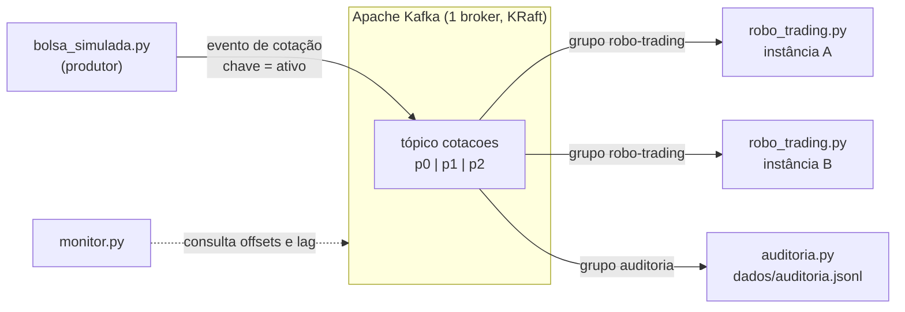

# Desacoplamento em Robôs de Trading com Apache Kafka — PoC

Prova de Conceito da **Prospecção Teórica e Tecnológica** (Engenharia de Software).

Uma bolsa de valores simulada publica cotações como **eventos** num tópico do Apache Kafka.
Serviços independentes consomem esses eventos: um robô que registra uma decisão no console e
um serviço de auditoria que guarda todos os eventos. O objetivo **não** é criar um sistema
financeiro: o domínio de trading é só o cenário para demonstrar, na prática, o
**desacoplamento** de uma arquitetura orientada a eventos (EDA).

## O que a PoC demonstra

| Evidência | Como aparece na demo | Cenário |
|---|---|---|
| O produtor não conhece os consumidores | Um 2º consumidor entra sem mudar nem reiniciar a bolsa | 2 |
| Publish/subscribe (*fan-out*) | Dois *consumer groups* recebem, cada um, **todos** os eventos | 2 |
| Desacoplamento temporal | Robô desligado: a bolsa continua, o *lag* cresce e nada se perde | 3 |
| Escala horizontal | Duas instâncias do robô dividem as partições automaticamente | 4 |
| Ordem por chave | Cada ativo cai sempre na mesma partição, em ordem | 1 e 4 |
| Evolução independente | A bolsa passa a publicar a versão 2 do evento e o robô antigo segue funcionando | 5 |
| Retenção e *replay* | Um grupo novo relê o histórico desde o início | 6 |
| Comparação com API síncrona | A mesma integração via HTTP: perde dados e fica lenta junto com o consumidor | 7 |

## Arquitetura



- **Mesmo grupo** (`robo-trading`): as instâncias **dividem** as partições (cada partição fica com uma instância por vez).
- **Grupos diferentes** (`robo-trading` × `auditoria`): cada grupo recebe a **sua própria cópia** de todos os eventos e anda no seu próprio ritmo.

### Contrato do evento

A única coisa que produtor e consumidores precisam combinar é o tópico (`cotacoes`) e o formato
do evento. A **chave** da mensagem é o código do ativo (ex.: `PETR4`), o que garante que todas as
cotações de um ativo vão para a mesma partição, em ordem.

Versão 1:

```json
{
  "id_evento": "a946fad8-6894-4a0d-9041-df6969759770",
  "versao": 1,
  "ativo": "PETR4",
  "preco": 37.28,
  "emitido_em": "2026-10-20T22:14:46.997+00:00"
}
```

Versão 2 (só **acrescenta** um campo opcional; quem lê a v1 continua funcionando):

```json
{ "...": "mesmos campos da v1", "versao": 2, "volume": 4458 }
```

Com 3 partições, os 6 ativos padrão ficam assim: **p0** = PETR4, WEGE3 · **p1** = PRIO3, RENT3 · **p2** = VALE3, ITUB4.

## Estrutura do projeto

```
prospeccao-kafka-trading/
├── docker-compose.yml        Kafka 4.3.1 (KRaft) + Kafka UI opcional
├── requirements.txt          confluent-kafka
├── bolsa_simulada.py         PRODUTOR    - publica cotações no tópico "cotacoes"
├── robo_trading.py           CONSUMIDOR 1 - grupo "robo-trading": decide COMPRAR/VENDER/MANTER
├── auditoria.py              CONSUMIDOR 2 - grupo "auditoria": grava todos os eventos em dados/
├── monitor.py                painel no terminal: partições, grupos, offsets e lag
├── dominio/                  regras do cenário, SEM Kafka (testáveis isoladamente)
│   ├── mercado.py            gera os preços (passeio aleatório) e monta o evento
│   └── estrategia.py         regra didática do robô (média móvel)
├── infra/
│   ├── config_kafka.py       endereço do broker, nome do tópico, criação do tópico
│   └── terminal.py           cores e formatação dos logs
├── comparativo_sincrono/     a MESMA integração via HTTP, sem Kafka (base de comparação)
│   ├── robo_api.py           o robô como API HTTP
│   └── bolsa_http.py         a bolsa chamando os consumidores diretamente
└── testes/
    └── test_dominio.py       testes das regras (rodam sem Kafka)
```

## Como rodar (Windows / PowerShell)

Pré-requisitos: **Docker Desktop** aberto e **Python 3.10+**.

**1. Subir o Kafka** (na pasta do projeto):

```powershell
docker compose up -d
docker compose ps        # espere o kafka-poc ficar "healthy" (uns 20 s)
```

> Se o container da versão anterior (`servidor_kafka`) estiver ligado, ele ocupa a porta 9092.
> Desligue-o antes: `docker stop servidor_kafka`.

Opcional, com interface web em http://localhost:8080:

```powershell
docker compose --profile ui up -d
```

**2. Preparar o Python:**

```powershell
python -m venv venv
.\venv\Scripts\Activate.ps1
pip install -r requirements.txt
```

> Se o PowerShell bloquear o `Activate.ps1`, rode antes
> `Set-ExecutionPolicy -Scope Process -ExecutionPolicy Bypass`.
> Cada terminal novo precisa ativar o venv de novo (ou usar `.\venv\Scripts\python.exe` no lugar de `python`).

**3. (Opcional) Rodar os testes das regras**, que não precisam do Kafka:

```powershell
python -m unittest discover -s testes -v
```

## Roteiro de demonstração

Cada serviço roda **no seu próprio terminal**: isso já mostra que são processos independentes.
No VS Code, use *Terminal → Split Terminal*. Para parar qualquer serviço: **Ctrl+C**.

### Cenário 1 — Fluxo básico: produtor → tópico → consumidor

```powershell
# Terminal 1
python monitor.py
# Terminal 2
python robo_trading.py --instancia A
# Terminal 3
python bolsa_simulada.py
```

**Observe:** cada cotação é gravada numa partição e recebe um *offset* crescente; o mesmo ativo
cai sempre na mesma partição; o robô registra a decisão e a idade do evento (~0 s); no monitor,
o LAG fica em 0.

### Cenário 2 — Um consumidor novo sem tocar no produtor

```powershell
# Terminal 4 (com a bolsa e o robô ainda rodando)
python auditoria.py
```

**Observe:** a auditoria começa no **offset 0** de cada partição (lê o histórico que já existia) e
depois acompanha em tempo real. A bolsa não foi alterada nem reiniciada. O monitor passa a
mostrar dois grupos, cada um com seus próprios offsets.

**Prova:** o produtor não sabe que a auditoria existe; cada grupo recebe uma cópia de tudo.

### Cenário 3 — Consumidor fora do ar (desacoplamento temporal)

1. **Ctrl+C** no robô. A bolsa continua publicando normalmente.
2. No monitor: grupo `robo-trading` fica **EMPTY** e o **LAG cresce**.
3. Religue: `python robo_trading.py --instancia A`.

**Observe:** o robô mostra `lendo a partir do offset X` (continua de onde parou) e processa o
atraso com a **idade** dos eventos em amarelo (eventos que esperaram no Kafka), até voltar a ~0 s.
O LAG volta a 0. Nenhuma cotação se perdeu.

### Cenário 4 — Escala horizontal com consumer group

```powershell
# Terminal 5 (com o robô A rodando)
python robo_trading.py --instancia B
```

**Observe:** os dois robôs mostram o **rebalanceamento**: A fica com `p0, p1` e B com `p2`. O monitor
mostra qual instância está com cada partição. Pare o B (Ctrl+C) e o A recebe tudo de volta.

Variações:
- Suba até 4 instâncias: a 4ª fica com **nenhuma** partição. O paralelismo de um grupo é limitado ao número de partições.
- Robô lento: `python robo_trading.py --instancia A --atraso 0.5`. A bolsa segue no mesmo ritmo e o LAG cresce. Suba a instância B para dividir a carga.

### Cenário 5 — Produtor evoluindo sem quebrar o consumidor

1. **Ctrl+C** na bolsa e suba a versão 2 do contrato: `python bolsa_simulada.py --versao 2`.
2. O robô **não foi alterado** e continua funcionando (ele lê só `ativo` e `preco`).
3. A auditoria passa a contar `v1` e `v2` e mostra o `volume`.

### Cenário 6 — Replay com um grupo novo

```powershell
python auditoria.py --grupo auditoria-2
```

Um grupo que nunca leu o tópico começa do início e regrava todo o histórico em
`dados/auditoria-2.jsonl`. Os eventos ficam retidos no log (24 h neste compose) e **cada grupo
controla a sua posição**. Em filas tradicionais (como as filas clássicas do RabbitMQ) a mensagem
sai da fila depois do *ack*; o RabbitMQ também tem *Streams*, que se aproximam do modelo de log
do Kafka.

### Cenário 7 — A mesma integração via HTTP síncrono (sem Kafka)

Pare os serviços Kafka e rode a base de comparação:

```powershell
# Terminal 1
python comparativo_sincrono/robo_api.py
# Terminal 2
python comparativo_sincrono/bolsa_http.py
```

1. **Ctrl+C no robô:** a bolsa passa a registrar `FALHA ... (cotação PERDIDA)`. No Windows, cada
   tentativa recusada pode levar uns 2 s, o que deixa a própria bolsa mais lenta.
2. **Robô lento:** `python comparativo_sincrono/robo_api.py --atraso 0.5`. A rodada da bolsa
   passa de ~0 s para ~3 s: ela fica esperando cada resposta.
3. **"Adicionar a auditoria":** suba `python comparativo_sincrono/robo_api.py --porta 8002 --nome auditoria`
   e **reinicie a bolsa** informando os dois endereços:
   `python comparativo_sincrono/bolsa_http.py --destinos http://127.0.0.1:8001/cotacoes,http://127.0.0.1:8002/cotacoes`

| Situação | HTTP síncrono | Kafka |
|---|---|---|
| Consumidor desligado | chamada falha, cotação perdida | evento fica no tópico; consumidor retoma do offset |
| Consumidor lento | produtor fica lento junto | produtor segue; o lag absorve a diferença |
| Novo consumidor | mudar a configuração e reiniciar o produtor | só subir o consumidor com outro `group.id` |
| Reprocessar o passado | impossível (nada foi guardado) | novo grupo lê desde o início |

A regra de decisão é **a mesma** nos dois casos (`dominio/estrategia.py`); só muda a integração.

### Kafka UI (opcional)

Com `docker compose --profile ui up -d`, abra http://localhost:8080: em **Topics → cotacoes** dá
para ver as partições e as mensagens; em **Consumers**, os grupos, os membros e o lag.

## Decisões de projeto

- **Chave = código do ativo.** Garante a ordem das cotações de cada ativo. Contrapartida: um ativo
  muito movimentado concentraria carga numa só partição (*hot partition*).
- **3 partições.** É o limite de paralelismo do grupo do robô. Aumentar depois muda o mapeamento
  chave → partição, e a ordem por ativo deixa de ser garantida durante a transição.
- **`acks=all` + idempotência no produtor.** O evento só conta como entregue depois de gravado, e
  as retentativas automáticas não criam duplicatas.
- **Commit manual depois de processar.** Dá a garantia *at-least-once*: se o consumidor cair entre
  processar e confirmar, a mensagem é entregue de novo. Por isso todo evento tem `id_evento`, que
  permitiria ao consumidor descartar duplicatas.
- **Onde cada consumidor começa.** O robô usa `auto.offset.reset=latest` (cotação velha não serve
  para decidir); a auditoria usa `earliest` (precisa de tudo). Quem decide é o consumidor, não o broker.
- **JSON + campo `versao` + leitor tolerante.** Simples para a PoC. Em produção usaríamos um
  *Schema Registry* (Avro/Protobuf) com regras de compatibilidade.
- **`partitioner=murmur2_random`.** O mesmo algoritmo do cliente Java: produtores em linguagens
  diferentes mandam a mesma chave para a mesma partição.
- **Domínio separado da infraestrutura.** `dominio/` não importa Kafka: dá para testar sem
  infraestrutura, e a mesma regra é usada pelas versões Kafka e HTTP.

## Limitações conhecidas

- **Um único broker, sem replicação.** Não demonstra tolerância a falha do próprio Kafka.
- **Estado do robô em memória.** Depois de um reinício ou rebalanceamento, a média móvel recomeça
  (por isso aparece `AGUARDANDO`). Ferramentas como Kafka Streams resolvem isso com *state stores*.
- **Ordem só dentro da partição.** Não existe ordem global entre ativos diferentes.
- **Sem *exactly-once* de ponta a ponta** (as transações do Kafka não foram usadas) e **sem
  segurança** (PLAINTEXT, sem TLS/SASL/ACL).
- **Regra de decisão didática.** Não é estratégia de investimento.

## Ambiente e versões

| Componente | Versão |
|---|---|
| Apache Kafka (imagem oficial `apache/kafka`, modo KRaft) | 4.3.1 |
| confluent-kafka (cliente Python, baseado na librdkafka) | 2.15.1 |
| Python | 3.10 ou superior |
| Kafka UI (`kafbat/kafka-ui`, opcional) | 1.5.0 |

## Solução de problemas

- **`Não consegui falar com o Kafka em localhost:9092`**: o container não está rodando ou ainda
  está iniciando. Confira com `docker compose ps`.
- **Porta 9092 em uso**: provavelmente o container da versão anterior. `docker ps` e depois `docker stop <nome>`.
- **Aviso de que o tópico tem menos de 3 partições**: o tópico foi criado em outro broker.
  Recomece do zero com `docker compose down` e `docker compose up -d`.
- **Recomeçar a demo do zero**: `docker compose down` apaga os eventos; apague também a pasta `dados/`.
- **Fechou o terminal pelo X em vez de Ctrl+C?** O Kafka só percebe que a instância saiu depois
  do `session.timeout.ms` (45 s). Com Ctrl+C a saída do grupo é imediata.

## Referências

- Apache Kafka — documentação oficial: https://kafka.apache.org/documentation/
- Apache Kafka — quickstart: https://kafka.apache.org/quickstart
- Confluent — Kafka com Python: https://developer.confluent.io/get-started/python/
- confluent-kafka-python — API: https://docs.confluent.io/platform/current/clients/confluent-kafka-python/html/index.html
- Red Hat — O que é arquitetura orientada a eventos: https://www.redhat.com/pt-br/topics/integration/what-is-event-driven-architecture
